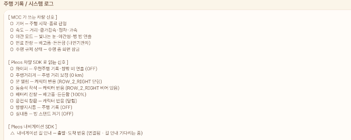

# MCC — My Car Character

**내 운전 습관이 캐릭터의 형질이 되고, 그 형질이 다른 운전자에게 유전되는 차량용 앱**

---

## 1. 앱 이름 및 한 줄 소개

| 항목 | 내용 |
|---|---|
| 앱 이름 | MCC (My Car Character) |
| 한 줄 소개 | 주행 데이터가 캐릭터의 외형 형질로 축적되고, 그 형질이 다른 차의 캐릭터에게 유전되는 차량 전용 육성 앱 |
| 패키지명 | `com.mcc.app` |
| 플랫폼 | Pleos Connect (Android Automotive OS) |

### 핵심 순환

```
알 ──(실제 30km 주행)──▶ 부화 ──(지역 20km)──▶ 지역 악세사리 ──(유전 코드)──▶ 다른 운전자와 유전 ──▶ 새 알
       │                    │
       └ 품는 동안의 운전 성향이  └ 종족 1/3 · 형질 5종 기본 20%
         맞는 형질 확률을 올림       + 운전 성향 · 부모 형질 가산
```

차량에서만 성립하는 구조로 설계했습니다.

- **알은 실제 주행 30km로만 부화합니다.** 버튼·광고 시청·결제로는 깨지지 않습니다. 30km를 채우면 알이 홈 한가운데서 흔들리고, 운전자가 **세 번 톡톡 눌러 깨웁니다** (금이 가다가 터지며 새 캐릭터가 튀어나옴). 홈에는 **정확한 진행도**(예: 부화까지 57.6% · 17.3 / 30 km · 남은 12.7 km)가 늘 보입니다.
- **확률을 바꾸는 건 차량 신호입니다.** 알을 품는 동안의 야간·급가감속·정차·평균속도·주행거리·**와이퍼(비 오는 날)** 가 형질 확률을 바꿉니다.
- **지역 악세사리는 그 지역을 실제로 20km 달려야 얻습니다.** 휴대폰 앱으로는 대체할 수 없고, 남의 지역 악세사리는 그 사람과 유전해야만 얻을 수 있습니다.

---

## 2. 실행 방법

> 에뮬레이터 설치, Virtual Console 연결, 차량 신호 조작을 포함한 상세 실행 절차는 **[`RUN.md`](RUN.md)** 에 정리했습니다.

### 2-1. 소스로 빌드

```bash
# 1) Android Studio 로 이 폴더를 엽니다 (File → Open → MCC)
#    첫 Gradle Sync 때 래퍼(gradlew)와 의존성이 자동으로 내려받아집니다.

# 2) 릴리즈 APK 빌드
./gradlew assembleRelease
# 출력: app/build/outputs/apk/release/app-release.apk

# 3) 에뮬레이터 또는 차량에 설치
adb install -r app/build/outputs/apk/release/app-release.apk
```

> `./gradlew` 가 없다면 Android Studio 에서 한 번 Sync 하거나
> `gradle wrapper` 를 실행하면 생성됩니다. Gradle 버전은 `gradle/wrapper/gradle-wrapper.properties` 에 8.13으로 고정해 두었습니다.

### 2-2. APK 로 바로 설치

`apk/` 폴더의 APK를 설치합니다.

```bash
adb install -r apk/teamMCC_MCC_release.apk
```

### 2-3. 앱 사용 순서

1. 앱 실행 → 차량·위치 권한 허용 → **시작 알** 을 받습니다
2. 기어 **D** → 주행 기록 시작. 메뉴·말풍선·대화상자가 닫히고 캐릭터만 '함께 달리는' 모습으로 남습니다
3. 기어 **P** → 주행이 알에 반영되고, 화면의 **'지금 부화하면'** 확률표가 바뀝니다
4. 누적 30km → 주차하면 알이 흔들리며 기다림 → **알을 3번 눌러 깨우기** → 아기가 **대표** 캐릭터가 됩니다 (보관 최대 7마리)
5. 대표 캐릭터로 한 지역을 20km 달리면 → 그 지역 **시그니처 악세사리**
6. **`기본 알 받기`** 로 부모 없는 알을 하나 더 받아 키울 수 있습니다 (자리가 남고 알이 없을 때)
7. 내 캐릭터 둘, 또는 내 캐릭터 + **다른 운전자의 유전 코드** → **알 만들기**
8. **도감**: 부화할 때마다 파츠가 1회씩 기록됩니다. 같은 파츠 3회 → ★ 색 변형, 6회 → ★★ 금빛. 보관함의 `파츠 꾸미기 ★` 로 입힙니다
9. **방 꾸미기**: 방 테마 10종(기본·지역 방 8·황금) + 소품 최대 4개. 소품은 홈 화면에서 **길게 눌러 끌면** 원하는 곳에 고정됩니다 (기어 P). 지역 아이템을 얻으면 그 지역 방이 열리고, 나머지는 누적 주행거리·도감으로 열립니다 (도감 31칸을 모두 ★ 이상으로 채우면 은색 트로피, 한 줄을 ★★ 로 채우면 금색 트로피)
10. 시동 직후·주차 직후·캐릭터를 눌렀을 때 **말풍선**(15자 이하, 3초). 상호작용은 **기어 P** 에서만
11. **밤·비 연출**: 오른쪽 위 🌙 밤 / ☔ 비 버튼으로 켜고 끔. 차가 야간 모드가 되거나 와이퍼를 켜고 끄면 자동으로 따라감. 화면 밝기 자체는 차량이 조절하고 앱은 분위기만 바꿈
12. **시연용 모두 해금**: `테스트` 메뉴에서 도감·악세서리·방을 한 번에 열고, 같은 버튼으로 원래대로 되돌림

> 실제 주행 없이 전체 흐름을 보려면 **`데모 주행`** 버튼을 누르세요.
> 누를 때마다 지역·스타일이 다른 가상 주행 1회가 **실제와 같은 경로**로 들어갑니다.
> 두 번째(장거리 고속, 강원)에서 시작 알이 30km를 채웁니다. 홈에서 알을 3번 누르면 강원 악세사리를 가지고 태어납니다.

---

## 3. 테스트 환경 및 필요한 설정

### 3-1. 개발 환경

| 항목 | 버전 |
|---|---|
| Android Gradle Plugin | 8.13.2 |
| Gradle | 8.13 |
| Kotlin | 2.0.21 |
| JDK (Gradle JDK) | 21 (Android Studio 내장 jbr-21) |
| Pleos SDK | `ai.pleos.playground:Vehicle:2.3.2`, `ai.pleos.playground:NaviHelper:3.0.5` |
| compileSdk / targetSdk | 34 |
| **minSdk** | **28** (공모전 요구: API 28 이상) |

### 3-2. 차량 API 설정 — 두 줄이 핵심입니다

```kotlin
// app/build.gradle.kts
android { useLibrary("android.car") }   // 없으면 import android.car.* 전부 컴파일 실패
```

```xml
<!-- AndroidManifest.xml -->
<uses-library android:name="android.car" android:required="false" />
<uses-feature android:name="android.hardware.type.automotive" android:required="true" />
```

### 3-3. 테스트 방법 — Pleos Connect 에뮬레이터

| 항목 | 값 |
|---|---|
| 에뮬레이터 | **Pleos Connect Emulator v2.1.0** (시스템 이미지 "Pleos Connect v2.1.0 APIs Intel x86_64 Atom", API 34) |
| 화면 규격 | **2560 × 1440, 160dpi** (가로). 세로 창·분할 창에서도 동작하도록 만듦 |
| AVD 설정 | RAM 4GB, Cold Boot |
| Virtual Console | `adb forward tcp:8088 tcp:8088` → 브라우저 `http://127.0.0.1:8088/` |

에뮬레이터의 **Virtual Console** 에서 차량 상태를 직접 조작해 테스트합니다.

| Virtual Console 항목 | 조작 | MCC 에서 보이는 것 |
|---|---|---|
| Gear | P ↔ D | 주행 시작·종료, 주행 중 화면 잠금 |
| Windshield Wiper | Off ↔ Low | 방 창밖에 비 (켜면 자동으로 켜지고 끄면 꺼짐) |
| Door Position | 닫힘 → 열림 | 캐릭터 말풍선 |
| Seat Occupancy (동승석) | Empty → Occupied | 캐릭터 말풍선 |
| Window Position (운전석) | 0 → 30% | 캐릭터 말풍선 |
| Battery SOC | 50 → 10 → 80 | 배고픔 → 든든함 말풍선 |
| Cabin Light | Off → On | 방 스탠드 불빛 |
| Turn Signal | Left/Right | 주행 요약의 방향지시등 횟수 |

말풍선과 버튼은 기어 P 에서만 나옵니다. 앱의 `테스트 → 차량 신호 점검` 에서 신호마다 수신 여부(O/△/X)를 볼 수 있습니다.

**최소 재현 시나리오 (3분)**

1. Gear `D` → 메뉴가 사라지고 '함께 달리는 중' 안내만 남는지 확인 (주행 규제)
2. Gear `P` → 메뉴가 돌아오는지 확인
3. Windshield Wiper `Low` → 방 창문에 비가 내리는지, `Off` → 그치는지 확인
4. Door Position 열기 → 캐릭터 말풍선 확인
5. 속도는 Virtual Console 로 바꿀 수 없으므로, 거리·부화는 `테스트 → 데모 주행` 으로 확인 (실제 주행과 같은 경로로 처리됨)

### 3-4. 네트워크 — 필요 없습니다

제출 버전은 **인터넷 연결이 전혀 필요하지 않습니다.** 네트워크 권한 자체를 선언하지 않았습니다.
주행 기록과 캐릭터 상태는 전부 차량 내부(`SharedPreferences`)에만 저장됩니다.
심사 환경에서 네트워크 상태와 무관하게 동일하게 동작합니다.

원본 GPS 좌표는 어디에도 저장하지 않습니다. 교류 기능(2차 고도화)에서도
서버로 보내는 값은 위치를 격자 단위로 뭉갠 해시와 시간 버킷뿐입니다.

### 3-5. 권한과 차량 신호 — 실제로 쓰는 것만 선언

**① 안드로이드 차량 표준 API** (Pleos 정책: 표준에 있는 건 표준으로)

| 권한 | 등급 | 쓰는 곳 |
|---|---|---|
| `android.car.permission.CAR_SPEED` | dangerous (실행 중 허용) | 속도 → 거리·급가감속·정차·과속 |
| `android.car.permission.CAR_POWERTRAIN` | normal | 기어 → 주행 시작·종료 |
| `android.car.permission.CAR_EXTERIOR_ENVIRONMENT` | normal | 야간 모드 → 방 밤 연출 |
| `android.car.permission.CAR_ENERGY` · `CAR_INFO` | dangerous · normal | 연료 잔량 % (FUEL_LEVEL ÷ INFO_FUEL_CAPACITY) — '표준 우선' 정책 |
| `ACCESS_FINE_LOCATION` · `ACCESS_COARSE_LOCATION` | dangerous (실행 중 허용) | 지역 이름 판정 (좌표 저장 안 함) |

**② Pleos 차량 SDK** `ai.pleos.playground:Vehicle:2.3.2` — 전부 읽기 전용, 설치 시 자동 허용 (`vehicle/PleosVehicle.kt`)

| 신호 | 권한 `pleos.car.permission.` | 게임에서 쓰는 곳 |
|---|---|---|
| 와이퍼 | `CAR_WINDOWS` | 방 창밖 비 · 우천주행 기록 · 품는 동안 와이퍼 켠 시간 20%↑ 물방울 모자, 25%↑ 우천형 확률 상승 |
| 주행거리계 | `CAR_DRIVE` | 주행 거리 보정 (5km 이상, 차이 ±30% 안일 때만) |
| 문 열림 (4개) | `CAR_DOORS` | 말풍선 "문 조심해!" |
| 동승석 착석 | `CAR_SEATS` | 말풍선 "친구도 탔네!" |
| 전기차 배터리 잔량 | `CAR_ENERGY` | 15% 이하 "배고파…" · 충전으로 10% 이상 늘면 "든든해!" |
| 운전석 창문 | `CAR_WINDOWS` | 말풍선 "바람 시원하다!" |
| 방향지시등 · 실내등 | `CAR_LIGHTS` | 주행 요약 "방향지시등 n회" · 실내등을 켜면 방 스탠드도 켜짐 |

**③ Pleos 내비게이션 SDK** `ai.pleos.playground:NaviHelper:3.0.5` (`vehicle/PleosNavi.kt`)

| 신호 | 권한 | 게임에서 쓰는 곳 |
|---|---|---|
| 길 안내 시작 · 목적지 도착 | `pleos.car.permission.NAVI_ROUTE` | 말풍선 "어디 가? 두근두근!" · "도착! 수고했어" · 주행 요약 "목적지 도착 n회" |

- 목적지 이름·주소·좌표는 읽지도 저장하지도 않습니다. 경로를 요청하지 않으므로 `NAVI_ROUTE_SEARCH` 는 선언하지 않았습니다.
- 차량을 조작하는 권한(`CONTROL_…`)은 하나도 선언하지 않았습니다.
- 신호는 '바뀔 때 알림'으로만 받고(폴링 없음), 하나가 지원되지 않아도 나머지는 그대로 동작합니다. Pleos 서비스가 없는 기기에서는 전부 꺼진 채로 앱이 동작합니다.
- 말풍선은 주행 중에는 뜨지 않습니다. 도착 인사는 화면 잠금이 풀릴 때 한 번 나옵니다.
- **연결하지 않은 것**: 타이어 공기압·경고등(공식 샘플이 일반 앱에 막아 둔 항목), 트렁크·프렁크·전조등·안개등·통행료·사이드미러·차량 제원(게임에 쓸 곳이 없거나 호출 방식을 실제 코드로 확인하지 못함).
- 권한을 묻기 전에 **무엇에 왜 쓰는지 먼저 안내**합니다. **차량 속도만 필수**입니다(주행 거리 → 알 성장). 거부해도 앱은 닫지 않고, 홈에 "허용하기" 안내를 띄워 켤 때마다 다시 묻습니다. 위치·차량 에너지는 처음 한 번만 묻고, 거부하면 지역 악세사리·연료 말풍선만 빠집니다. 한 번 허용하면 다시 묻지 않습니다. 설정 탭 '권한'에서 상태를 보고, 꺼진 권한은 눌러서 켜고 켜진 권한은 안드로이드 설정에서 끌 수 있습니다 (`PermissionGate.kt`).

> ⚠ Pleos SDK 호출부는 공개된 공모전 앱·공식 샘플의 실제 호출 코드를 보고 작성했지만, 이 저장소를 만든 환경에서는 SDK 파일을 내려받을 수 없어
> **실제 SDK 로 빌드해 보지 못했습니다.** Android Studio 에서 빌드 오류가 나면 오류 메시지 그대로 고치면 됩니다 (대개 메서드 이름·인자 한 줄).

### 3-6. Pleos 가이드라인 준수

| Pleos 문서 | 요구 | MCC |
|---|---|---|
| [개발 환경 설정](https://document.pleos.ai/docs/connect/guide/getting-started/application-development/setup-connect-sdk-emulator) | minSdk 28 이상, Gradle 8.0 이상, Pleos Connect 에뮬레이터 v2.1.0 (API 34) | minSdk 28, Gradle 8.13, API 34 |
| [SDK API 정책](https://document.pleos.ai/docs/pleos-only/vehicle-app-planning-guide/pleos-connect-sdk-api) | 속도·기어 같은 표준 차량 데이터는 AAOS Car API 사용 (표준 우선) | `CarPropertyManager` 로 속도·기어·야간 모드 |
| [API 호환성](https://document.pleos.ai/docs/pleos-only/vehicle-app-planning-guide/api-compatibility-availability) | 차종 이름이 아니라 지원 여부로 판단 | `getCarPropertyConfig` 로 지원 확인, 없으면 null 로 건너뜀 |
| [Connect SDK](https://document.pleos.ai/docs/pleos-only/connect-sdk-pleos/) · [심사 기준](https://document.pleos.ai/docs/pleos-only/distribute/app-review-guide/review-functionality-performance-stability) | 필요한 권한만, 승인된 범위 안에서 | 읽기 권한만 선언 (제어 권한 0개), 쓰는 곳은 3-5 표 |
| [주행 규제 정책](https://document.pleos.ai/docs/pleos-only/vehicle-app-planning-guide/driving-restiction-policy) | DO 선언이 없으면 주행 중 사용 불가 | `distractionOptimized` 선언 |
| [주행 규제 개발 가이드](https://document.pleos.ai/docs/pleos-only/vehicle-app-developer-guide/driving-restriction-development-guide) | `CarUxRestrictionsManager` 리스너로 규제를 받아 스스로 제한 | 규제가 켜지면 본문·버튼·대화상자를 모두 닫고 안내 한 줄만 표시 |
| [주행 안전 설계](https://document.pleos.ai/docs/pleos-only/vehicle-app-planning-guide/driver-distraction-guideline) | 주행 중 게임 등 주의 분산 활동 유도 금지, 움직이는 이미지 최소화 | 주행 중에는 캐릭터·알 화면 자체를 숨김 |
| [보안·개인정보](https://document.pleos.ai/docs/pleos-only/vehicle-app-planning-guide/security-privacy) | 위치 요청 시 목적 안내, 불필요한 개인정보 저장 금지 | 권한 요청 전 목적 안내, 좌표 미저장, 네트워크 없음, 백업 끔 |
| 심사 기준 — 안정성 | 더미 데이터·임시 콘텐츠 금지 | 시연 도구는 `SHOW_DEMO_TOOLS=false` 로 숨김 (마켓 제출 빌드) |
| [디자인 가이드 — 텍스트](https://document.pleos.ai/docs/connect/guide/docs-design/foundations/typography) | 짧은 문장, 한 문단 3줄 이하, 중요 정보 5mm↑ · 보조 3mm↑ | 최소 20sp(≈3.2mm), 주행 중 안내·화면 제목 32sp(≈5.1mm), 대화상자 글자도 키움. 안내 문구는 한 줄 40자 이하로 줄임, 말풍선 15자 이하(테스트) |
| 심사 기준 — 디스플레이 | 안전 영역 준수, 창 크기 변경 시 상태 유지 | `fitsSystemWindows`, `configChanges` 로 재생성 없이 유지 |

> 앱 카테고리는 **라이프스타일**(운전 습관 기반 육성)로 신청할 계획입니다.

---

### 3-6. 차량 신호 점검 결과 (Pleos Connect v2.1.0 에뮬레이터 · 2026-11-12)

앱의 `테스트 → 차량 신호 확인` 화면입니다. Virtual Console 로 신호를 바꿔 가며 확인했습니다.



| 구분 | 결과 |
|---|---|
| Android 표준 신호 (기어·속도·야간 모드·연료·주행 규제) | 5개 모두 O |
| Pleos 차량 SDK 신호 | 지금 쓰는 8개 모두 O (와이퍼·주행거리계·문·동승석·배터리·창문·방향지시등·실내등) |
| Pleos 내비게이션 SDK | O (연결됨, 길 안내 대기) |

O = 값을 받고 있음 · △ = 연결됐지만 아직 값이 오지 않음 · X = 사용 불가

> 캡처는 신호 12개를 쓰던 때의 화면입니다. 그중 에뮬레이터에서 반응을 검증할 수 없는 4개(안전벨트·실내 온도·주행 모드·워셔액)는 검증되지 않은 기능을 내지 않기 위해 앱에서 뺐고, 해당 권한(`CAR_CLIMATE`·`CAR_SAFETY`)도 선언에서 지웠습니다.

## 4. APK 파일 위치

```
apk/teamMCC_MCC_release.apk
```

- 공모전 규칙에 따른 파일명: `팀명_앱이름_release.apk`
- 실행 가능한 release 빌드입니다 (Android Studio → Build Variants → `release` → Build → Build APK(s) → `app/build/outputs/apk/release/app-release.apk` 를 위 이름으로 바꿔 `apk/` 에 넣음)
- 용량이 GitHub 업로드 한도를 넘으면 GitHub **Releases** 에 올리고 그 페이지 주소를 적습니다
- 심사용 APK 는 시연 도구(데모 주행·직접 운전 시뮬레이터·차량 신호 점검·시연용 모두 해금)를 **켜 둔** 빌드입니다. 실제 주행 없이 전체 기능을 확인할 수 있게 하려는 것이며, App Market 제출 때는 `SHOW_DEMO_TOOLS=false` 로 끕니다

---

## 5. 프로젝트 구조

```
MCC/
├── README.md                    ← 이 문서
├── RUN.md                       ← 실행 방법 (에뮬레이터 설치부터)
├── apk/                         ← 제출용 APK
└── app/src/
    ├── main/
    │   ├── AndroidManifest.xml      ← automotive feature, 차량·위치 권한, distractionOptimized
    │   ├── java/com/mcc/app/
    │   │   ├── MainActivity.kt      ← 화면·버튼. 기어 D→P 감지, 500ms 샘플링, 주행 중 조작 차단
    │   │   ├── game/
    │   │   │   ├── Game.kt          ← 게임 규칙: 7슬롯 · 시작 알 · 30km 부화 · 지역 20km · 유전 조건
    │   │   │   ├── Texts.kt         ← 화면 문장 (확률표, 캐릭터 카드)
    │   │   │   ├── Collection.kt    ← 도감: 부화 횟수 · 1/3/6회 ★ 단계 · 단계 입히기
    │   │   │   ├── Room.kt          ← 방 꾸미기: 테마 10 (기본·지역 8·황금) · 소품 9 (4개까지 자유 배치) · 해금 조건
    │   │   │   ├── Greetings.kt     ← 말풍선 문구 (15자 이하)
    │   │   │   └── Samples.kt       ← 시연용 샘플 운전자 3명
    │   │   ├── trait/
    │   │   │   ├── Traits.kt        ← 형질 20종 · 종족 3종 정의
    │   │   │   ├── Genetics.kt      ← 확률 규칙 (조정 값은 파일 상단 상수)
    │   │   │   ├── GeneCode.kt      ← 유전 코드 (C3152-A407X) 변환·오타 감지
    │   │   │   └── TraitEngine.kt   ← 주행 기록 → 운전 성향 집계
    │   │   ├── region/Region.kt     ← 8개 지역 · 악세사리 · 오프라인 GPS 지역 판정
    │   │   ├── vehicle/
    │   │   │   ├── VehicleRepository.kt ← 차량 신호 읽기 + 신호 가용성 점검
    │   │   │   ├── LocationTracker.kt   ← GPS → 지역 (좌표는 저장하지 않음)
    │   │   │   ├── DrivingSession.kt    ← 1회 주행 집계 (거리·급가감속·정차·야간·지역별 거리)
    │   │   │   ├── DemoDrive.kt         ← 시연용 가상 주행 (실제와 같은 경로로 들어감)
    │   │   │   └── SimDrive.kt          ← 직접 운전 시뮬레이터 (가속·제동을 물리적으로 계산)
    │   │   ├── ui/CharacterView.kt  ← 레이어 그림 겹치기 · 숨쉬기 · 프레임 재생 · 메모리 절약 로딩
    │   │   ├── ui/Recolor.kt        ← ★/★★ 전용 그림이 없을 때 색 바꿔 그리기
    │   │   ├── vehicle/PleosVehicle.kt ← Pleos 차량 SDK 신호 8개 (읽기 전용)
    │   │   ├── vehicle/PleosNavi.kt ← Pleos 내비게이션: 길 안내 시작·도착
    │   │   ├── game/VehicleMoments.kt ← 차량 상태 변화 → 캐릭터가 반응할 '순간'
    │   │   ├── ui/RainView.kt       ← 방 창문 안에만 내리는 비 (와이퍼 연동)
    │   │   ├── ui/WindowMask.kt     ← 창문 마스크 그림(room_xxx_window.png)에서 유리 범위 계산
    │   │   ├── ui/SimPanel.kt       ← '직접 운전해 보기' 화면 (기어·목표 속도·운전 방식·야간·지역·배속)
    │   │   └── data/LocalStore.kt   ← 차량 내부 저장 (네트워크 없음)
    │   └── res/
    │       ├── drawable-nodpi/      ← 캐릭터·방·소품 그림 (팀 자체 제작)
    │       └── …                    ← 차량 화면 기준 (본문 16sp+, 버튼 64dp+, 다크)
    └── test/java/com/mcc/app/       ← 단위 테스트 112개
```

### 설계 원칙

| 원칙 | 코드 위치 |
|---|---|
| 많이 타는 사람이 유리하지 않다 — 거리는 "성격"을 정하고 "등급"을 정하지 않는다 | 확률 조건이 `avgKmPerDrive`(1회 평균)를 쓰고 `totalKm`(총합)을 쓰지 않음 |
| 운이 아니라 운전이 확률을 바꾼다 | `Genetics.STYLE_RULES` — 품는 동안의 운전 성향이 맞는 형질 +30 |
| 과속은 벌하지 않고 성장을 늦춘다 — 캐릭터에 상처를 입히지 않는다 | `TraitEngine.accumulate()` 의 `× 0.5` 둔화 / 무과속 `× 1.3` 보너스 |
| 종족에 서열이 없다 | 고양이·시바견·곰 각 1/3, 능력치 차이 없음 |
| 남의 지역은 남을 통해서만 | 지역 악세사리는 직접 20km 달리거나, 가진 운전자와 유전해야만 얻음 |
| 주행 중에는 조작하게 하지 않는다 | `MainActivity.setDrivingLock()`, Manifest 의 `distractionOptimized` |
| 신호 하나가 막혀도 앱은 멈추지 않는다 | 모든 읽기가 `try/catch → null`, GPS 가 없으면 지역만 빠지고 나머지는 정상 |
| 위치는 저장하지 않는다 | 좌표 → 지역 이름으로 즉시 변환, 저장되는 건 지역별 거리뿐 |

---

## 6. 확률 규칙과 검증

### 확률 규칙

| 항목 | 규칙 | 상수 (`Genetics.kt`) |
|---|---|---|
| 종족 | 고양이 · 시바견 · 곰 각 **1/3** | `PARENT_SPECIES_BONUS = 0` |
| 모자·눈·입·의상 | 5종 각 **20%** 에서 출발 | `BASE_WEIGHT = 20` |
| ↳ 운전 성향 | 알을 품는 동안의 운전이 조건에 맞는 형질 **+30** (20% → 약 38%) | `STYLE_BONUS = 30` |
| ↳ 부모 형질 | 부모가 가진 형질 **+20** (부모 한쪽마다) | `PARENT_BONUS = 20` |
| 지역 악세사리 | 한 지역 **20km** 주행 시 획득. 품는 동안 20km 면 반드시 가지고 태어남 | `REGION_UNLOCK_KM = 20` |
| ↳ 유전 | 부모가 가진 악세사리 **부모 한쪽마다 +10%** | `ACCESSORY_PER_PARENT = 0.10` |

### 시뮬레이션 결과

**① 운전이 실제로 결과를 바꾸는가** — 스타일별로 알 2,000개를 품어 부화

| 품는 동안의 운전 | 많이 나온 형질 (기본 20%) |
|---|---|
| 출퇴근 도심 | 택시기사 모자 38% · 인내의 일자 입 34% |
| 장거리 고속 | 하품 40% · 피곤한 눈 39% · 장거리형 37% · 고글 모자 36% |
| 야간 주행 | 빛나는 눈 39% · 야간형 38% |
| 급한 운전 | 슬픈 눈 38% · 번개 모자 38% · 꾹 다문 입 36% |
| 느긋한 운전 | 미소 41% · 모범형 39% · 웃는 눈 38% |
| 비 오는 날 (와이퍼) | 우천형 37% · 물방울 모자 36% |

**② 다양성** — 운전자 1,000명이 각자 첫 알을 부화하면 **서로 다른 캐릭터 775종**
(가능 1,875종), 가장 흔한 조합도 **0.4%**. "겹치지 않는 캐릭터"라는 전제가 성립합니다.

**③ 악세사리 유전** — 부모 둘이 악세사리 3종(부산·경상·제주)을 나눠 가졌을 때
아기가 하나 이상 물려받을 확률 **27.4%** (이론값 27.1%).

### 단위 테스트 112개

```
Android Studio → app/src/test 폴더 우클릭 → Run 'Tests in com.mcc.app'
```

| 테스트 | 검증 내용 |
|---|---|
| `PermissionGateTest` (7) | 첫 실행에 한 번에 묻기 · 이후엔 빠진 속도만 · 위치·에너지 거부해도 핵심 동작 · 대략 위치로 충분 · 두 번 거부 뒤 설정 안내 · 설정 탭 권한 목록 · 선택 권한 다시 켜기 |
| `DecorTouchTest` (3) | 캐릭터 뒤 소품 잡기 — 소품의 그려진 곳만 소품으로 판정 · 투명한 모서리 제외 · 손가락 여유 |
| `EggHatchTest` (4) | 누를 때마다 금이 늘고 3번째에 터짐 · 금은 알 그림 안 · 그림의 투명 여백 제외 · 정확한 진행도 문장(다 안 찼으면 100%·30.0km 로 안 보임) |
| `GeneticsTest` (14) | 종족 1/3 · 형질 20% · 확률 합 = 1 · 운전 가산 16종 전부 도달 가능 · 기본 형질 4종은 가산 안 됨 · 와이퍼 켠 시간 → 물방울 모자·우천형 · 부모 가산 · 악세사리 10% · 3만 회 뽑기 빈도 |
| `GeneCodeTest` (7) | 왕복 변환 3,000건 · **한 글자 오타 9만여 건 전부 감지** · 소문자·대시 생략·O/0 혼동 허용 |
| `RegionTest` (10) | 8개 지역 실제 장소 26곳 판정 · 해외(에뮬레이터 기본 위치) → 지역 없음 |
| `GameRulesTest` (16) | 시작 알 · 기본 알 · 30km 채우면 저절로 안 깨지고 눌러서 부화 · 20km 악세사리 1회만 · 대표만 지역 거리 · 7슬롯 · 유전 조건 · 놓아주기 · 자리 없을 때 부화 대기 · 알 품는 동안 기존 캐릭터 외형 고정 |
| `DrivingSessionTest` (4) | 거리 적분 · 지역 경계 통과 시 거리 분할 · 5초 추월은 무과속 인정 |
| `FrameSequenceTest` (3) | 프레임 그림 왕복 재생 순서 · 0.125초 간격 |
| `SimDriveTest` (6) | 60km/h 30분 ≈ 30km · 급하게 모드 급가감속 발생 · 야간·과속 기록 · 배속 바꿔도 결과 동일 · 시뮬 주행으로 실제 부화 |
| `CollectionTest` (9) | 도감 31칸 · 부화 때 파츠별 +1 · 1/3/6회 단계 · 열린 단계만 입히기 · 놓아줘도 기록 유지 · 옛 저장에서 도감 채우기 · **도감이 부화 확률을 바꾸지 않음** |
| `VehicleSignalsTest` (11) | 착석 값 뒤집기(에뮬레이터 확인) · 연료 % 계산(표준 FUEL_LEVEL) · 처음 받은 값은 기준만 · 문·동승자·창문·충전구 전환 1회 반응 · 연료 15% 이하/주유 · 배터리·연료 따로 기억 · 모든 순간에 대사 · 주행거리계 보정(짧거나 크게 다르면 무시) · 방향지시등·도착 횟수 |
| `RoomAndGreetingTest` (14) | 누른 자리 → 그림 픽셀 좌표(투명한 곳은 누름 아님) · 와이퍼 상태 이름 → 비 판정 · 모든 방에 창문 자리(비 연출) · 창문 마스크 범위 계산 · 스탠드만 불빛 · 방 기본값 · 지역 아이템 → 지역 방 8종 · 주행거리·도감 해금 · 도감 전체 ★ → 은색 트로피 · 소품 4개 제한 · 옮긴 위치가 화면 안으로 · 잠긴 저장값은 기본으로 · 소품 비우기 · 말풍선 전부 15자 이하 · 단계 색 변환(외곽선·흰색·투명 유지, ★★ 금빛) |

> 급가감속 3.0 / −3.5 m/s² 는 텔레매틱스 업계 관행값입니다. 내비 과속 경고 신호를
> 연결하기 전까지는 110km/h 초과를 과속으로 봅니다. 실차 데이터가 나오면
> `DrivingSession.kt`·`MainActivity.kt` 의 상수만 조정하면 됩니다.

---

## 7. 심사 기준 대응

| 심사 기준 | MCC의 근거 |
|---|---|
| **차량특화성** | 부화가 실제 주행거리로만 진행 · 형질 확률을 바꾸는 게 차량 신호 · 지역 악세사리는 그 지역을 실제로 달려야 획득 · 주행 중 조작 차단 구현 |
| **창의성** | 주행 이력이 일시적 표정이 아니라 **영구적 외형 형질**로 축적되고, 그것이 **다른 운전자에게 유전**된다. 1인 완결 구조가 아니라 타인 없이 성립하지 않는다 |
| **기술 활용성** | AAOS `CarPropertyManager` 직접 연동 · `CarUxRestrictionsManager` 로 주행 중 UI 제어 · 신호 가용성 런타임 점검 · 권한 거부에 대한 graceful degradation |
| **사업성** | 차량 보유가 전제 조건인 구조 → 신차 구매 동기와 직결 · 캐릭터 자랑을 통한 바이럴 · 지역 형질이 지역 마케팅 연계 가능 |


## Pleos 개발자 가이드 점검표 (2026-11-11 기준)

| 가이드 | 요구 | MCC |
|---|---|---|
| 개발 환경 | minSdk 28↑, Gradle 8↑, Emulator 2.1.0, Cold boot, RAM 4GB | minSdk 28 · AGP 8.13 · Pleos Connect v2.1.0 API 34 |
| SDK 정책 | 표준(AAOS)에 있는 값은 표준으로 (속도·기어·외기온·연료) | 속도·기어·야간·연료 = 표준, 나머지 = Pleos SDK |
| SDK 사용 신청 | Vehicle State·NaviHelper 는 '사용 가능' (신청 불필요) | 해당 2개만 사용 |
| 권한 | 승인 안 된 권한 선언 시 반려, 제어 권한 금지 | Playground 'Vehicle State·NaviHelper' 목록에 있는 읽기 권한만 선언 (READ_WINDSHIELD_WIPERS·CAR_MILEAGE 제거, 목록에 없는 충전구 API 제거) |
| 주행 규제 | CarUxRestrictions 로 제한, 주행 중 애니메이션 최소화 | 주행 중 메뉴·대화상자 닫음, 캐릭터·비 멈춤 |
| 게임·미디어 | 주행 시작 시 일시정지·UI 숨김 | 조작 UI 전부 숨김, 멈춘 캐릭터 + 안내 한 줄만 |
| CCP Back 키 | 첫 화면에서 finish 금지, moveTaskToBack(true) | 적용 |
| CCP | 사용자 설치 앱은 선택, 터치로 모든 기능 가능해야 함 | ROTARY_SUPPORTED=false 선언 |
| 글자 | 중요 5mm↑ · 보조 3mm↑, 최소 12sp, 3줄 이하 | 최소 20sp, 주행 안내 32sp |
| 대비 | 글자·아이콘 4.5:1 이상 | 회색 글자 #765F4F(5.3:1), 버튼 #8A6243(흰 글자 5.4:1) |
| 성능 | 실행·로딩 10초, 터치 반응 0.25초, 주행 중 CPU 5% 미만, RAM 400MB↓ | 주행 중·앱이 가려졌을 때·움직일 게 없는 그림은 타이머 정지, 백그라운드 확인 0.5→2초, GPS 2→10초, 그림은 줄여서 읽고 캐시는 힙의 1/8 (측정법: RUN.md) |
| 창 | 세로·가로 둘 다 깨지지 않게, 상태 유지 | configChanges 로 상태 유지 (폼 팩터 테스트 필요) |
| 개인정보 | 쓰기 전에 목적 안내, 동의 버튼만 동의 | 권한 요청 전 목적 안내 (취소 불가, 확인 버튼만) |
| 제출물 | 아이콘 512×512 · 스크린샷 2~8장 (2560×1380 / 1700×1212 / 840×1212) · 앱 이름 30자↓ | 제출 시 준비 |
